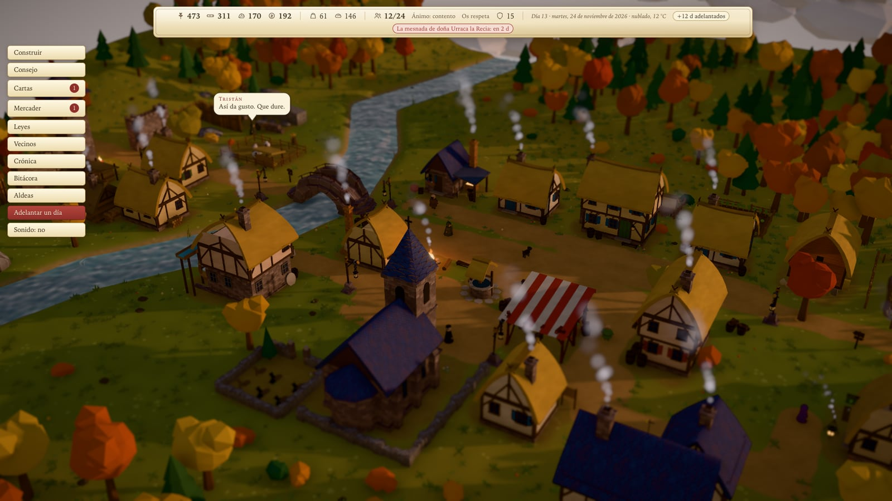
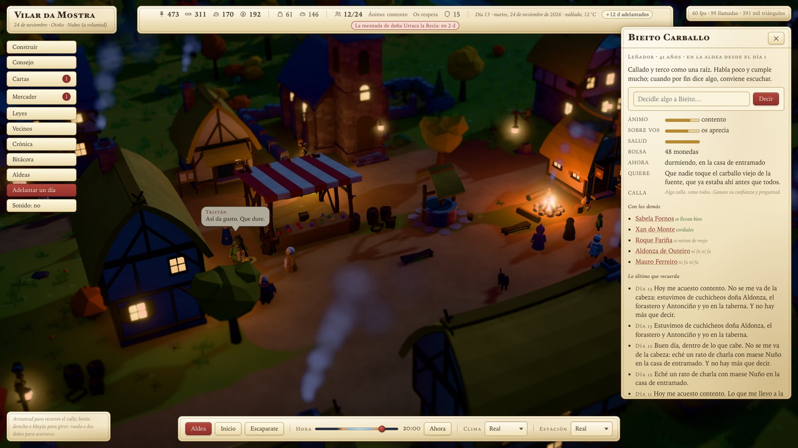
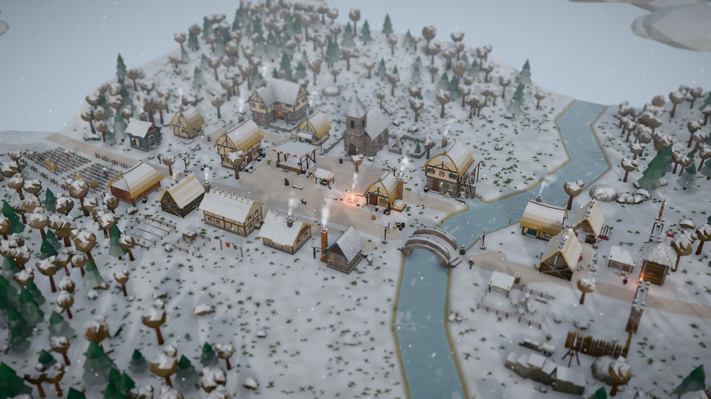
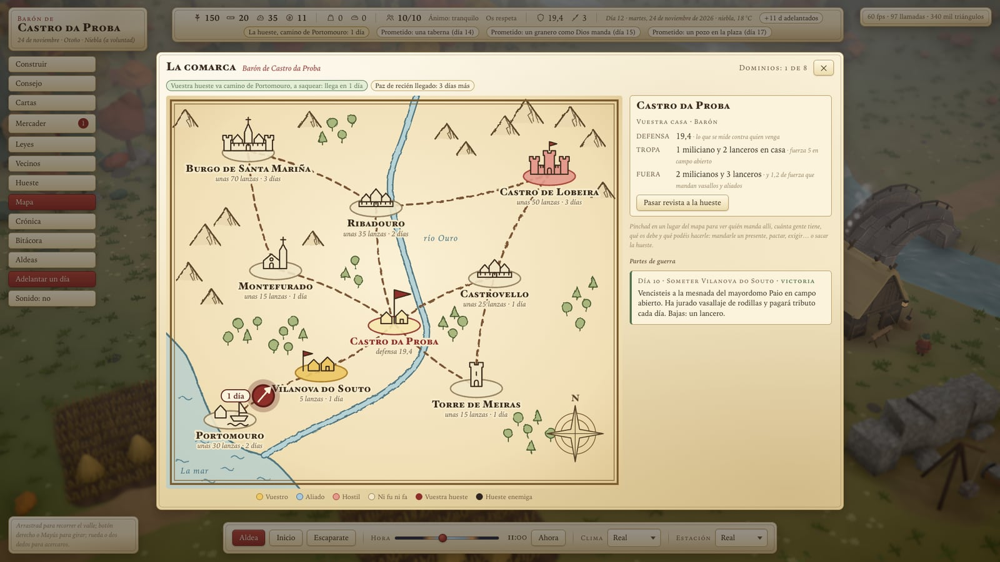
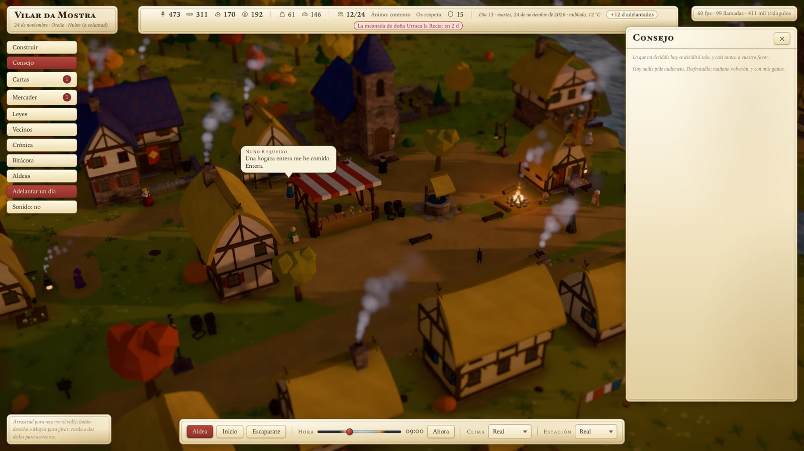

# Pedrafonte

A 3D medieval village game where the villagers are played by an LLM.

You're the lord of a small village in a Galician valley. You build, set taxes and laws, deal with the neighbouring villages, and listen to twelve villagers who have their own jobs, secrets, debts and grudges. The game runs on real time: the sun, moon, weather and season match the real ones.



## How the AI fits in

The model never touches the game state directly. It returns a JSON proposal (what a villager says, how they feel, what they want to do) and the engine in `mundo/aldea/motor/validador.py` either accepts it as a whole or rejects it and logs why. That keeps the simulation consistent and testable, and the game still works with no model at all.

There are two engines behind the same interface:

- `simulado`: template based, free and deterministic. It's the default and what the tests use.
- `claude`: uses the Anthropic API, with a daily spending cap per village. Once it hits the cap, the simulated engine takes over until the next day.

## What's in it

- **Scene**: a diorama-style valley with an animated river, 35 buildings, real sun and moon positions, real weather from Open-Meteo, seasons, shadows, ambient occlusion and tilt-shift. It holds 60 fps at around 100 draw calls.
- **Villagers**: relationships, memories ranked by importance, rumours that change as they spread, daily routines, small scenes between 2 to 4 characters and a nightly reflection.
- **Economy**: building with preview, roads and walls, production chains (field, mill, bakery), housing and seasonal harvests. All content lives in YAML files under `mundo/datos/`.
- **Government**: a daily council with petitions, promises you can keep or break, taxes, laws, hunger and revolts.
- **Outside world**: neighbouring lords you trade, marry and fight with by letter, travelling merchants, festivals on their real dates, bandits, wolves and plague.
- **Region and war**: tutorial, regional map, territories and troops.
- **Several villages**: each one with its own landscape, tone and difficulty.
- **Sound**: ambience and music generated in code, no audio files.

<table>
<tr>
<td></td>
<td></td>
</tr>
<tr>
<td></td>
<td></td>
</tr>
</table>

The game text is in Spanish.

## Structure

```
juego/          client: Vite, TypeScript, Three.js (custom shaders, n8ao, postprocessing, suncalc)
mundo/          server: Python 3.12, FastAPI, SQLAlchemy, Alembic, WebSocket
  aldea/motor   simulation: economy, routines, rumours, council, laws, war
  aldea/ia      the two AI engines
  datos/        game content in YAML
  tests/        pytest suite, including the whole API on SQLite
herramientas/   model optimisation, screenshots, headless play-through
docs/           design notes, API, assets and licences
```

## Running it

You need Node 20+, Python 3.12 and Docker (SQLite works too).

```bash
cp .env.ejemplo .env   # set a database password
./arrancar.sh          # database, server on :8765 and game on :5173
```

The 3D model packs (Medieval Stylized Assets by alefranart and Slavic World by EmaceArt) aren't included because their licences don't allow it. [`assets/LEEME.md`](assets/LEEME.md) explains how to get them.

Tests and checks:

```bash
cd mundo && .venv/bin/pytest -q
cd juego && npm run build
node herramientas/prueba-partida.mjs
```

3D assets belong to their authors, see [`docs/LICENCIAS.md`](docs/LICENCIAS.md).
